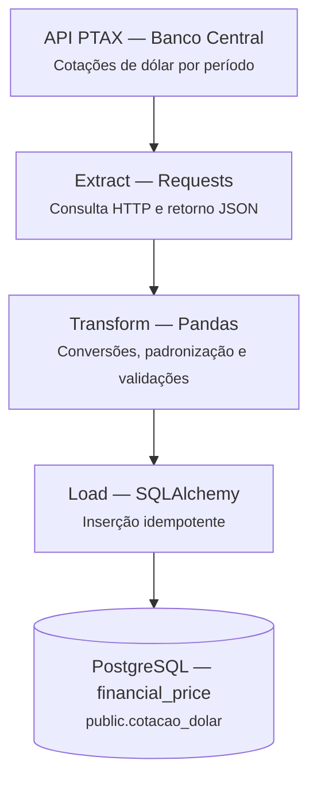

<h1 align="center">Pipeline de Cotação do Dólar</h1>


<!--  -->
<!-- 
 -->
<!--  -->

---

<p align="center">
    Pipeline ETL de acompanhamento da cotação do dólar diariamente
</p>

---

<p align="center">
  <a href="https://www.python.org"></a>
</p>

## Índice

- [Sobre o Projeto](#-sobre-o-projeto)
- [Arquitetura](#-arquitetura)
- [Stacks](#-stacks)
- [Estrutura do Projeto](#-estrutura-do-projeto)
- [Instalação](#-instalação)
- [Sobre mim](#-sobre-mim)

---
## Sobre o Projeto

Este projeto foi desenvolvido para portfólio, com o objetivo de estudar e aprender ETL e Engenharia de Dados na prática.

O pipeline consome dados diários da API PTAX Banco Central, realiza o tratamento e validação dos dados utilizando Pandas. O armazenamento ocorre utilizando carga incremental ao verificar a última data registrada no banco de dados e evita a duplicidade através do `ON CONFLICT DO NOTHING`.

##  Arquitetura




## Stacks

### Core

- **Python 3.14+** - Linguagem utilizada
- **PostgreSQL 14** - Banco de dados relacional

### Bibliotecas

- **pandas** - Manipulação e transformação de dados
- **requests** - Requisições HTTP para a API
- **SQLAlchemy** - Gerenciamento de conexões e execuções de operações SQL
- **psycopg2** - Driver PostgreSQL
- **python-dotenv** - Gerenciamento de variáveis de ambiente

### Outras

- **Jupyter Notebook** - Análise exploratória de dados
- **uv** - Gerenciador de pacotes Python rápido

---

## Estrutura do Projeto

- ### EXTRACT
**Arquivo:** [`src/extract.py`](src/extract.py)

**Objetivo:**
1. Requisição HTTP GET para a API do PTAX Banco Central, com tempo limite de resposta
2. Valida o status code da resposta
3. Valida os dados e salva uma cópia JSON em `data/cotacao.json`
4. Retorna os dados

- ### TRANSFORM
**Arquivo:** [`src/transform.py`](src/transform.py)

**Objetivo:**
1. Cria o DataFrame
2. Realiza a conversão dos dados e renomeia colunas
3. Valida valores não nulos e positivos

- ### LOAD
**Arquivo:**[`src/load.py`](src/load.py)

**Objetivo:**
1. Coleta as chaves de segurança em `config/.env`
2. Conexão com o banco de dados
3. Verifica se há conflito de chave primária e ignora
4. Insere os dados no banco de dados
5. Verifica a quantidade de registros

- ### MAIN
**Arquivo:**[`main.py`](main.py)

**Objetivo:**
1. Coleta as chaves de segurança em `config/.env`
2. Conexão com o banco de dados
3. Consulta a última data chave do banco de dados, realizando a carga incremental
4. Executa o pipeline completo com requisitos de segurança como verificação da data e dados recebidos vazios

## Instalação

### 1. Clone o repositório

```bash
git clone https://github.com/gmderim0726/financial-price-pipeline.git
cd financial-price-pipeline
```

### 2. Adicionando as bibliotecas

```bash
uv sync
```

### 3. Criando o banco de dados

```bash
psql -U postgres
```

```sql
CREATE DATABASE financial_price OWNER [DB_USER];
\c financial_price
CREATE TABLE public.cotacao_dolar (
    cotacao_compra numeric(10,4) NOT NULL,
    cotacao_venda numeric(10,4) NOT NULL,
    data_hora timestamp NOT NULL PRIMARY KEY
);
```

Atualize o `[DB_USER]` com o seu usário de acesso ao banco de dados.

### 4. Configure as Variáveis de Ambiente

Crie um arquivo `.env` dentro da pasta `config/`, baseado na `.env.example` e configure as credenciais.

### 5. Execução do main.py

```bash
uv run main.py
```

<!-- # Sobre mim -->